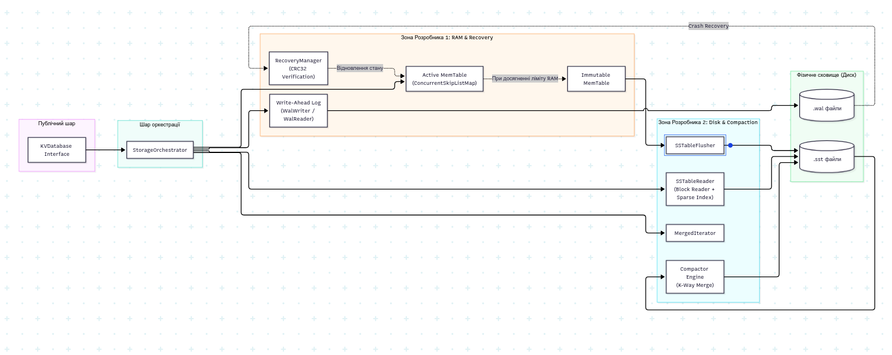

# J-LSM: Вбудоване Key-Value сховище — Дизайн-документ

| **Параметр**        | **Значення**                                                |
|---------------------|-------------------------------------------------------------|
| **Проєкт**          | J-LSM (Java Log-Structured Merge Key-Value Engine)          |
| **Тип документа**   | Дизайн-документ архітектури та стратегії тестування         |
| **Стек**            | Java 21 (java.base, без зовнішніх фреймворків)              |
| **Формат поставки** | Автономна бібліотека (JAR), без UI та мережевого рівня      |
| **Команда**         | 2 розробники (Розподіл: RAM & Recovery / Disk & Compaction) |
| **Перевіряє**       | Грибенко Дмитро В'ячеславович                               |

## 1. Резюме

**J-LSM** — це готова бібліотека для Java, яка допомагає зберігати дані у форматі «ключ-значення» (Key-Value). Вона працює за принципом LSM-дерева: нові дані спочатку швидко записуються в пам'ять та журнал, а потім упорядковано зберігаються на диску. Це забезпечує надійність і цілісність даних навіть у разі раптового вимкнення чи збою системи.

Головна мета проєкту — дослідити та практично реалізувати базові механізми LSM-дерев: послідовний запис у журнал (WAL), збереження відсортованих даних на диск у вигляді окремих файлів (SSTable) з індексом для швидкого пошуку, а також фонове об'єднання цих файлів для видалення застарілих записів.

Критерії успішності:

- Успішне відновлення даних після раптових аварій або програмних помилок.

- Ефективне читання з диска невеликими порціями (по 4 КБ) без завантаження всього файла в оперативну пам'ять.

- Повна відповідність за логікою роботи еталонній моделі в пам'яті (TreeMap).

- Високий рівень якості та перевірки коду тестами (покриття ≥ 90%, мутаційний бал ≥ 80%).

## 2. Контекст і межі

Бібліотека розробляється як вбудований рушій зберігання даних. Вона працює всередині тієї ж програми Java, що й основний застосунок, і напряму взаємодіє з файловою системою за допомогою стандартних засобів Java I/O.

### Межі системи:

- **Формат даних:** Ключі та значення приймаються як звичайні масиви байтів (byte[]). Сховище автоматично сортує всі ключі за їх байтовим порядком.

- **Синхронізація:** Можна налаштувати, чи потрібно відразу примусово зберігати кожен запис на диск для надійності, чи використовувати швидший буферизований запис.

- **Робота з файлами:** Всі файли сховища (.wal та .sst) зберігаються в окремій папці. Додаткові сторонні сервіси чи фонові процеси не потрібні.

## 3. Цілі та не-цілі

### Цілі (Goals)

- **G1:** Реалізація повного циклу роботи з даними: Оперативна пам'ять → Журнал запису → Файли на диску → Фонове об'єднання файлів.

- **G2:** Надійне відновлення даних у разі раптового вимкнення програми чи пошкодження файлів за допомогою контрольних сум (CRC32).

- **G3:** Економне використання пам'яті: файли читаються блоками фіксованого розміру, без завантаження великих обсягів у пам'ять.

- **G4:** Послідовне читання діапазонів: можливість отримувати всі дані у визначеному проміжку ключів із правильним сортуванням.

- **G5:** Глибоке тестування: перевірка правильності роботи автоматичними тестами, симуляцією збоїв та перевіркою стійкості коду.

### Не-цілі (Non-Goals)

- **Графічний інтерфейс та мережа:** Відсутні візуальні інтерфейси або мережеві протоколи. Взаємодія відбувається виключно через кодовий Java API.

- **Додаткові кеші та фільтри:** Складні оптимізації читання (наприклад, фільтри Блума чи кeш блоків) свідомо не реалізуються, щоб зберегти фокус на базових алгоритмах.

- **Складні транзакції:** Немає підтримки багатокрокових ізольованих транзакцій. Безпека одночасних записів забезпечується простими блокуваннями.

- **Стиснення даних:** Дані зберігаються без стиснення для спрощення тестування та перевірки точних розмірів файлів.

## 4. Розподіл зон відповідальності в команді

Проєкт розробляється командою з двох інженерів з чітким розподілом завдань на роботу з оперативною пам'яттю та з диском.



| **Модуль**                | **Відповідальний** | **Зона відповідальності**                                                                                            | **Ключові артефакти**                                                |
|---------------------------|--------------------|----------------------------------------------------------------------------------------------------------------------|----------------------------------------------------------------------|
| **RAM & Crash Recovery**  | **Розробник 1**    | Управління даними в пам'яті, запис у журнал дій, обробка помилок та відновлення стану після збоїв                    | MemTable, WalWriter, WalReader, RecoveryManager                      |
| **Disk I/O & Compaction** | **Розробник 2**    | Формат файлів на диску, читання та запис блоками, створення індексів для швидкого пошуку та фонове об'єднання файлів | SSTableWriter, SSTableReader, SparseIndex, Compactor, MergedIterator |

## 5. Архітектура та інтерфейси

### 5.1 Публічний інтерфейс (Public API)

Зовнішній інтерфейс максимально простий і ховає всю внутрішню складність роботи з файлами та синхронізацією:

```java
public interface KVDatabase extends AutoCloseable {
    void put(byte[] key, byte[] value) throws StorageException;
    byte[] get(byte[] key) throws StorageException;
    void delete(byte[] key) throws StorageException;
    
    // Ітератор діапазону [fromKey, toKey) з детермінованим порядком
    ClosableIterator<Entry> scan(byte[] fromKey, byte[] toKey) throws StorageException;
    
    // Примусовий запис даних на фізичний носій
    void sync() throws StorageException;
    
    @Override
    void close() throws StorageException;
}

public record Entry(byte[] key, byte[] value, boolean isTombstone) {}
```


### 5.2 Внутрішні контракти між шарами

Для паралельної розробки та зручного поєднання модулів створено два основні внутрішні контракти:

#### Контракт скидання на диск (Flush Contract):

Коли оперативна пам'ять заповнюється (наприклад, досягає 4 МБ), накопичені дані передаються модулю збереження на диск:

```java
public interface SSTableFlusher {
    // Приймає відсортовані записи, формує новий файл SSTable і повертає його метадані
    SSTableMetadata flush(Iterator<Entry> sortedEntries) throws IOException;
}
```

#### Контракт читання з диска (Disk Search Contract):

Модулі пам'яті та диска об'єднуються через спільні методи для пошуку окремих ключів або сканування діапазонів:

```java
public interface DiskStorageReader {
    // Точкове читання: повертає значення або Tombstone, якщо ключ знайдено
    Optional<Entry> search(byte[] key) throws IOException;
    
    // Повертає сортований ітератор по всіх активних SSTables
    ClosableIterator<Entry> scanDisk(byte[] fromKey, byte[] toKey) throws IOException;
}
```

### 5.4 Життєвий цикл та реалізація операцій

#### 5.4.1 Операція запису (put(key, value))

1.  **Послідовний запис у WAL:** Формується бінарний фрейм: `[CRC32 (4 байти)][Тип: 0x01 (1 байт)][KeyLen (4 байти)][ValLen (4 байти)][Key][Value]`. Запис виконується в кінець поточного .wal файлу через FileChannel.write(). Відповідно до конфігурації викликається force(false) для негайного скидання на фізичний диск або операція буферизується ОС.

2.  **Вставка в MemTable:** Дані вставляються в активну MemTable (структура ConcurrentSkipListMap або TreeMap з ReadWriteLock) виключно після успішного підтвердження запису у WAL, що гарантує відсутність фантомних записів у RAM при аварії I/O. Ключі впорядковуються за беззнаковим байтовим порядком (Arrays.compareUnsigned).

3.  **Контроль порогу та Flush Trigger:** Оновлюється лічильник зайнятої пам'яті allocatedBytes. Якщо розмір перевищує MEMTABLE_THRESHOLD (4 МБ):

    - Поточна MemTable позначається як Immutable MemTable.

    - Створюється нова порожня Active MemTable та відкривається новий файл .wal.

    - Запускається фоновий процес скидання (SSTableFlusher).

#### 5.4.2 Операція видалення (delete(key))

1.  У WAL записується фрейм типу 0x02 (DELETE) з ValLen = 0.

2.  У MemTable додається маркер видалення (Tombstone): Entry(key, null, isTombstone = true).

3.  Фізичне видалення даних з диска не відбувається миттєво; Tombstone маскує старіші версії даних до моменту виконання Compaction.

#### 5.4.3 Точкове читання (get(key))

Пошук виконується за принципом ранньої зупинки (Short-Circuit) у хронологічному порядку від найновіших даних до найстаріших:

1.  **Active MemTable:** пошук у пам'яті. Якщо знайдено: якщо це Tombstone — повертається null, інакше повертається значення.

2.  **Immutable MemTable:** пошук у пам'яті незмінної таблиці. Якщо знайдено — обробляється аналогічно.

3.  **Дискові SSTables:** пошук послідовно від найновішого SSTable до найстарішого:

    - Бінарний пошук у завантаженому Sparse Index для визначення діапазону блоку `[firstKey_i <= key < firstKey_{i+1}]`.

    - Зчитування з диска одного фіксованого блоку даних розміром 4 КБ за знайденим Offset.

    - Пошук ключа всередині ліченого 4 КБ блоку. Якщо знайдено — повертається результат (або null для Tombstone), пошук негайно припиняється.

4.  Якщо ключ не знайдено в жодному SSTable — повертається null.

#### 5.4.4 Читання діапазону (scan(fromKey, toKey))

Використовується алгоритм K-way Merge сортованих ітераторів:

1.  Ініціалізуються під-ітератори: subMap з Active MemTable, subMap з Immutable MemTable (якщо існує), та по одному ітератору на кожен SSTable (початковий блок визначається через Sparse Index).

2.  Ітератори об'єднуються в пріоритетну чергу (PriorityQueue / Min-Heap):

    - Первинний пріоритет: беззнаковий лексикографічний порядок ключів.

    - Вторинний пріоритет: номер покоління джерела (новіші структури мають перевагу перед старішими).

3.  **Дедуплікація:** якщо вершина купи та наступні ітератори мають однаковий ключ, старіші ітератори просуваються вперед без виведення їхніх значень. Tombstone-записи відфільтровуються.

#### 5.4.5 Фонове ущільнення (Compaction)

Фоновий процес зливає кілька SSTable файлів в один новий файл шляхом потокового K-way merge. Застарілі версії ключів видаляються, а Tombstones остаточно знищуються, якщо об'єднуються всі наявні покоління SSTable.


### 5.3 Формати зберігання даних

#### Формат журналу попереднього запису (WAL)

Усі операції записуються послідовно в кінець файла. Кожен запис містить чітку структуру та перевірочні дані:

| **CRC32**            | **Тип запису** | **Довжина ключа** | **Довжина значення** | **Ключ**       | **Значення**   |
|----------------------|----------------|-------------------|----------------------|----------------|----------------|
| 4 байти (IEEE 802.3) | 1 байт (P/D)   | 4 байти           | 4 байти              | Змінна довжина | Змінна довжина |

*Типи записів:* 0x01 — звичайне додавання/оновлення (PUT), 0x02 — позначка про видалення (DELETE).

#### Формат файлу таблиці сортованих рядків (SSTable)

Файли на диску розбиті на блоки по 4 КБ. Наприкінці файла зберігається покажчик (індекс), який допомагає швидко знаходити потрібні блоки з даними.

| Секція | Опис структури та вміст |
| --- | --- |
| Data Blocks (Блоки даних) | Послідовні блоки розміром ≤ 4 КБ кожен (Data Block 0, Data Block 1, ...). Кожен блок містить:<br>• Кількість записів (4 байти)<br>• Записи: KeyLen (4B) \| ValLen (4B) \| Flags (1B) \| Key \| Value |
| Sparse Index Block (Рідкісний індекс) | Блок індексу для швидкого пошуку блоків даних:<br>• Кількість записів індексу (4 байти)<br>• Записи: Offset (8B) \| BlockSize (4B) \| FirstKeyLen (4B) \| FirstKeyBytes |
| Footer (Підніжжя) | Фіксована кінцева секція (20 байтів):<br>• Index Offset (8B) \| Index Length (8B) \| Magic Number 0x4A4C534D (4B) |


## 6. Стратегія тестування

Тестування гарантує правильність роботи сховища шляхом порівняння з еталонною моделлю, перевірки крайових випадків та симуляції аварійних ситуацій.


### 6.1 Test Oracle

1.  **Еталонна модель у пам'яті (TreeMapOracle):** Проста реалізація на базі стандартного TreeMap. Будь-які дії в J-LSM повинні давати точно такий самий результат, як і в цій моделі.

2.  **Перевірка структури файлів (SSTableDumpOracle):** Інструмент для зчитування дискових файлів, який перевіряє правильність збереження блоків та індексів.

### 6.2 Каталог перевірок

#### L1 — Модульні тести (Unit Tests)

- **U-01:** Перевірка правильного порівняння байтових ключів різної довжини.

- **U-02:** Перевірка запису та зчитування журнальних даних із розрахунком контрольних сум.

- **U-03:** Точний запис та читання окремого блока даних розміром 4 КБ.

- **U-04:** Створення та обробка позначок про видалення ключів.

- **U-05:** Зчитування підсумкових даних файла та реакція на пошкоджений формат.

#### L2 — Властивості та інваріанти (Property-Based Tests, інструмент: jqwik)

- **P-01 (Збереження та відновлення):** Будь-які згенеровані дані після кодування та декодування повинні повністю збігатися з початковими.

- **P-02 (Впорядкованість індексу):** Ключі в індексі повинні йти суворо в порядку зростання.

- **P-03 (Швидкий пошук за індексом):** Будь-який існуючий ключ повинен точно знаходитися в тому блоці, який вказано в індексі.

- **P-04 (Безпечність фонового об'єднання):** Об'єднання декількох файлів у один не повинно змінювати чи втрачати жодних актуальних даних.

- **P-05 (Пріоритет видалення):** Якщо ключ було видалено, будь-який запит повинен повертати порожній результат, навіть якщо раніше існувало значення.

#### L3 — Диференційні тести (Differential Testing)

- **D-01 (Порівняння основних операцій):** Виконання тисяч випадкових операцій (запис, читання, видалення) паралельно на J-LSM і на еталонній моделі з постійною перевіркою збігу результатів.

- **D-02 (Порівняння читання діапазонів):** Перевірка того, що отримані списки елементів у заданому проміжку ключів в J-LSM та еталоні повністю ідентичні.

#### L4 — Стійкість та відновлення (Resilience & Crash Simulation)

- **R-01 (Тест раптового вимкнення):** Штучне аварійне завершення програми під час запису. Після повторного запуску всі підтверджені дані повинні успішно відновитися.

- **R-02 (Обрізаний журнал запису):** Симуляція неповного запису останнього кадру в журнал. Система повинна відновити цілісну частину і продовжити роботу без падінь.

- **R-03 (Пошкодження даних у файлі):** Навмисна зміна байтів у журналі. Система повинна помітити помилку завдяки контрольній сумі, зупинити зчитування пошкоджених даних і повідомити про це.

#### L5 — Мутаційне тестування та якість коду

- **G-01 (Покриття коду тестами):** Перевірка того, що тести виконують щонайменше 90% усього коду ядра.

- **G-02 (Мутаційне тестування):** Автоматичне внесення дрібних помилок у код програми для перевірки, чи помічають їх тести (необхідно знаходити ≥ 80% помилок).

### 6.3 Архітектура Fault Injection та матриця збоїв

#### 6.3.1 Архітектурні рішення для симуляції аварій

- **Декоратор файлових операцій (FaultInjectingFileChannel):** Обгортка над FileChannel, яка дозволяє детерміновано симулювати апаратні відмови під час тестів за допомогою методів: failAfterBytesWritten(bytes), failOnSync(), corruptByte(offset), failWithDiskFull().

- **Атомарний запис SSTable (Shadow Writing):** Нові дискові файли створюються у тимчасових файлах (.sst.tmp). Перейменування у фінальний .sst виконується атомарно (Files.move із ATOMIC_MOVE) лише після запису Footer та виклику force(true). Недописані тимчасові файли очищаються при старті.

- **Ідемпотентність та відновлення WAL (Log Truncation):** Валідація кожного кадру за CRC32. При виявленні обірваного чи пошкодженого кінця файлу RecoveryManager зупиняється на останньому коректному записі та обрізає пошкоджений "хвіст" (channel.truncate()).

#### 6.3.2 Матриця тестів стійкості (Fault Injection Matrix)

- **FI-01 (Torn Write у WAL):** Обрив запису посеред кадру WAL. Очікувана поведінка: відновлення всіх попередніх цілісних записів, автоматичне обрізання битого хвоста файлу, продовження нормальної роботи. Захист: валідація CRC32 та truncate.

- **FI-02 (Bit Rot у WAL):** Інверсія байта в записаному фреймі. Очікувана поведінка: розпізнавання пошкодження через розбіжність CRC32, зупинка зчитування з викиданням CorruptedLogException. Захист: контрольна сума CRC32 IEEE 802.3 у кожному кадрі.

- **FI-03 (Crash під час Flush):** Аварійне переривання під час запису SSTable до запису Footer. Очікувана поведінка: ігнорування та видалення файлу .sst.tmp при рестарті, повне відновлення стану зі збереженого WAL (який видаляється лише після успішного Flush). Захист: тимчасові файли та затримка видалення журналу.

- **FI-04 (Crash між створенням SSTable і видаленням WAL):** Збій одразу після перейменування SSTable, але до видалення старого .wal. Очікувана поведінка: база зчитує і SSTable, і WAL, але завдяки дедуплікації даних стан повністю відповідає еталону без дублювання. Захист: ідемпотентне злиття та дедуплікація записів.

- **FI-05 (Crash під час Compaction):** Переривання процесу фонового злиття. Очікувана поведінка: видалення незавершеного файлу злиття; вихідні SSTables залишаються незмінними та доступними. Захист: незмінність (immutability) активних SSTable файлів.

- **FI-06 (Disk Full під час put()):** Симуляція відсутності місця на диску під час запису у WAL. Очікувана поведінка: метод put() повертає StorageException, MemTable залишається незмінною, розбіжність між RAM та диском не виникає. Захист: збереження в пам'ять лише після успішного запису на диск.

- **FI-07 (Пошкодження Footer або Sparse Index):** Пошкодження Magic Number (0x4A4C534D) у Footer. Очікувана поведінка: SSTable маркується як невалідний, запобігаючи читанню некоректних даних. Захист: перевірка магічного числа та розміру Footer (20 байт).

## 7. Наскрізні інженерні аспекти

### 7.1 Управління ресурсами пам'яті та гарантії RAM

#### 7.1.1 Формальні гарантії використання RAM (Upper Bound)

Загальне споживання пам'яті бібліотекою обмежене формулою:

`RAM_total <= RAM_ActiveMemTable + RAM_ImmutableMemTable + RAM_SparseIndex + RAM_IO_Buffers + RAM_MergeHeap`

- **Active MemTable:** до 4 МБ (налаштовуваний ліміт). Облік розміру ключів, значень та об'єктного оверхеду вузлів дерева.

- **Immutable MemTable:** до 4 МБ (максимум одна таблиця). Застосовується механізм зворотного тиску (Backpressure): якщо фоновий потік Flush не встиг скинути таблицю на диск до моменту повторного заповнення Active MemTable, нові операції put() тимчасово блокуються, унеможливлюючи витік пам'яті.

- **Sparse Index:** близько 10-15 МБ на 1 ГБ дискових даних. Зберігається лише 1 покажчик (Offset, BlockSize, FirstKey) на кожні 4 КБ даних.

- **I/O Buffers:** не більше (кількість активних потоків \* 4 КБ). Повне читання SSTables у пам'ять заборонено; читання виконується суворо через циклічні буфери по 4 КБ.

- **Merge Heap (Scan та Compaction):** обмежується розміром K * 4 КБ, де K — кількість файлів, що зливаються одночасно.

#### 7.1.2 Методика верифікації та перевірки обмежень пам'яті

1.  **JVM Heap Constraint Tests (-Xmx):** Виділений набір тестів запускається у форкнутому процесі JVM із жорстким обмеженням пам'яті: -Xmx32m -Xms32m. У сховище записується від 100 до 500 МБ даних із паралельним повним скануванням. Успішне проходження без OutOfMemoryError підтверджує дотримання стелі пам'яті.

2.  **Верифікація зворотного тиску (Backpressure Assertion):** Мок-тест штучно блокує запис на диск під час Flush і перевіряє, що після заповнення другої таблиці клієнтський потік блокується, а сумарна кількість таблиць у RAM суворо не перевищує 2.

3.  **Моніторинг пам'яті під навантаженням:** Використання ManagementFactory.getMemoryMXBean() під час навантажувальних тестів для контролю стабільності розміру купи після проходження Garbage Collection.

### 7.2 Детермінізм та безпека I/O

- Порівняння ключів завжди виконується за єдиними правилами незалежно від налаштувань операційної системи.

- Файли названі з використанням простих порядкових номерів (наприклад, 000001.wal, 000002.sst), що забезпечує зрозумілий порядок їх зчитування при старті.

## 8. План реалізації та контрольні точки

| Етап | Результат та критерії приймання |
| --- | --- |
| M0 | Узгоджено формати файлів та внутрішні контракти. Налаштовано проєкт і системи автоматичного тестування. |
| M1 | Розробник 1: Реалізовано зберігання даних у пам'яті та базовий запис у журнал.<br>Розробник 2: Реалізовано запис даних на диск окремими блоками. |
| M2 | Розробник 1: Реалізовано читання журналу та відновлення після збоїв.<br>Розробник 2: Реалізовано покажчик (індекс) для швидкого пошуку блоків на диску. |
| M3 | Інтеграція: автоматичне збереження накопичених у пам'яті даних на диск. Успішне проходження базових тестів. |
| M4 | Реалізація фонового об'єднання дискових файлів та очищення від видалених записів. |
| M5 | Реалізація послідовного читання діапазонів даних (scan). |
| M6 | Перевірка стійкості коду мутаційними тестами та виправлення слабких місць. |
| M7 | Завершення проєкту: підготовка демонстраційної утиліти, вимірювання швидкодії та захист. |


## 9. Аналіз ризиків

| **Ризик**                                          | **Вплив** | **Стратегія запобігання / Вирішення**                                                              |
|----------------------------------------------------|-----------|----------------------------------------------------------------------------------------------------|
| **Зависання або уповільнення Pitest**              | Високий   | Важкі мутаційні тести запускаються лише для найважливіших модулів ядра, виключаючи допоміжний код. |
| **Витік файлових дескрипторів під час сканування** | Середній  | Обов'язкове гарантоване закриття відкритих файлів після завершення зчитування.                     |
| **Розбіжності у сортуванні байтів між Java та ОС** | Високий   | Використання власного строго визначеного модуля порівняння ключів.                                 |

## 10. Фокус рецензування

1.  Чи є запропоновані внутрішні контракти достатніми для зручної та незалежної розробки двох модулів?

2.  Чи достатньо спрощеного фонового об'єднання файлів для демонстрації принципів LSM без переускладнення проєкту?

3.  Чи достатньо описаних перевірок відновлення та стійкості для підтвердження надійності сховища?