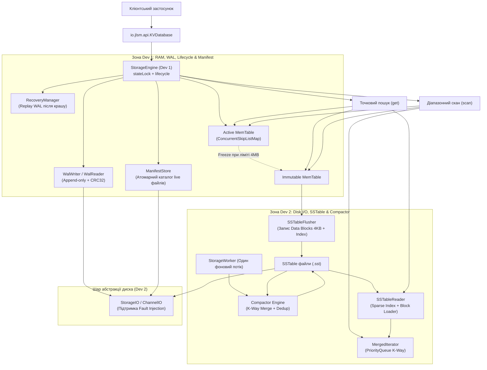
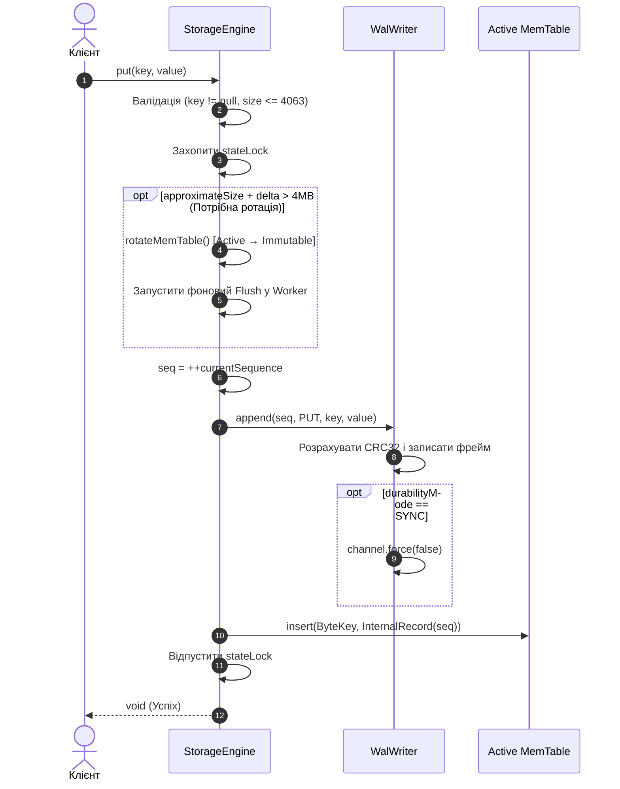
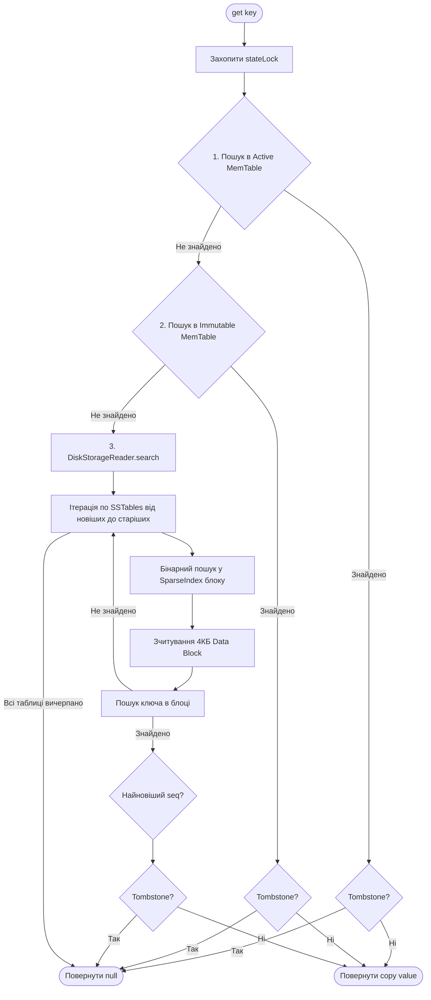
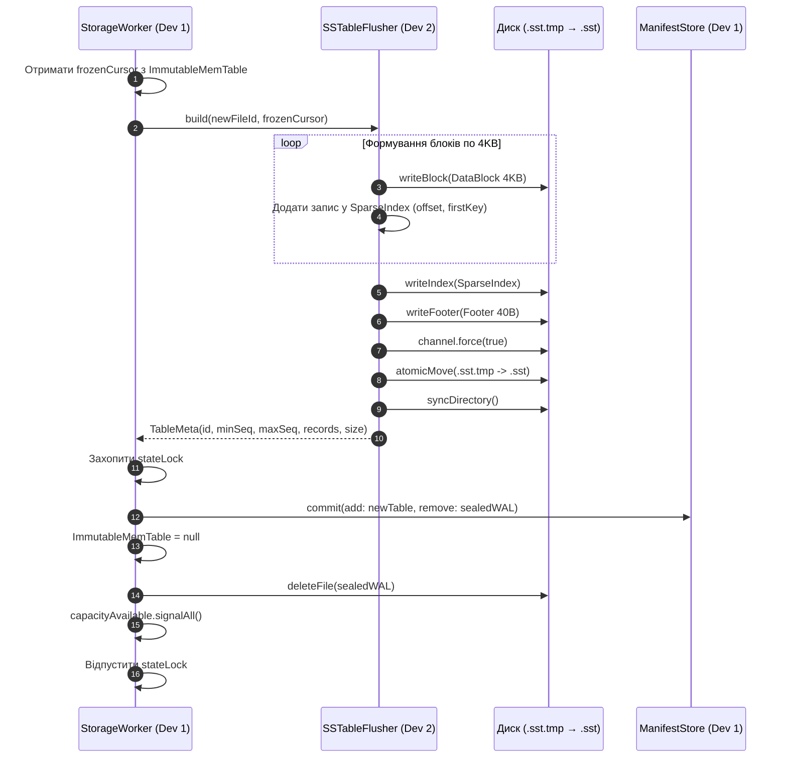
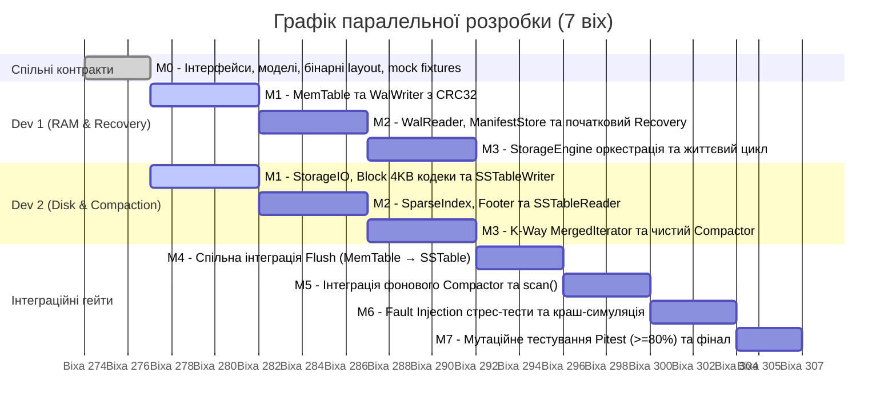

# DEVELOPMENT.md: Технічна специфікація та спільний контракт розробки J-LSM

**Версія:** 1.0  
**Цільова платформа:** Java 21 (виключно `java.base`, без сторонніх бібліотек у main)  
**Формат поставки:** Автономна бібліотека (JAR), без UI та мережевого рівня  
**Призначення документа:** Нормативне технічне керівництво для двох розробників (**Dev 1** та **Dev 2**), а також системний промпт-контракт для AI-асистентів (LLM / Cursor / Copilot). Будь-який код, згенерований людиною чи штучним інтелектом, повинен суворо відповідати цим специфікаціям.

## 0. Інструкція для AI-асистента (AI Agent Operating Rules)

Якщо цей документ завантажено в контекст AI-асистента для написання чи рев'ю коду, ШІ **зобов'язаний** дотримуватися таких правил:

1. **Ізоляція ролей:** Завжди уточнюйте або визначайте, для якої ролі генерується код:
   * **Dev 1 (RAM & Recovery):** реалізує пакети `mem`, `wal`, `manifest`, `engine`. Не модифікує внутрішню реалізацію SSTable та Compaction.
   * **Dev 2 (Disk I/O & Compaction):** реалізує пакети `internal.io`, `sst`, `merge`, `compaction`. Не змінює логіку WAL, MemTable та координатора Engine.
2. **Незмінність спільних контрактів:** Інтерфейси в пакетах `io.jlsm.api` та `io.jlsm.internal.model` є замороженими. Заборонено додавати, видаляти чи змінювати сигнатури методів без прямої вказівки.
3. **Правило володіння даними (Defensive Copying):**
   * Усі масиви `byte[]`, що надходять з публічного API або повертаються клієнту, **повинні копіюватися** (`Arrays.copyOf` або `clone()`).
   * Утиліта порівняння ключів — **виключно `Arrays.compareUnsigned()`**. Жодних перетворень у `String` чи стандартного `Comparable<byte[]>`.
4. **Робота з файлами та I/O:**
   * Ніколи не викликати `Files.readAllBytes()` для файлів SSTable.
   * Весь I/O здійснюється виключно через інтерфейси `StorageIO` та `ChannelIO` з використанням прямих або виділених буферів `ByteBuffer` розміром до 4096 байтів.
5. **Обробка помилок:**
   * Не ковтати `IOException`. Будь-яка невідповідність бінарного формату або контрольної суми — це `StorageException(ErrorCode.CORRUPTION)` або типізовані `CorruptedLogException` / `CorruptedTableException`.

## 1. Загальна архітектура системи

J-LSM реалізує спрощене Log-Structured Merge (LSM) дерево. Записи спочатку додаються в журнал випереджального запису (WAL) на диску, після чого фіксуються в оперативній пам'яті (MemTable). При заповненні MemTable скидається на диск у незмінний файл SSTable. Періодично фоновий процес Compactor зливає декілька SSTable в один, видаляючи застарілі версії ключів і надгробки (Tombstones).



## 2. Матриця відповідальності (Dev 1 vs Dev 2)

| Модуль | Пакет | Відповідальний | Вхідні залежності | Що надає назовні |
| :---- | :---- | :---- | :---- | :---- |
| **I/O Abstraction** | `io.jlsm.internal.io` | **Dev 2** | `java.nio.channels` | Інтерфейси `StorageIO`, `ChannelIO`, `FaultInjectingStorage` |
| **Shared Model** | `io.jlsm.internal.model` | **Спільно** | Немає | `ByteKey`, `InternalRecord`, `RecordKind`, `KeyRange` |
| **MemTable** | `io.jlsm.mem` | **Dev 1** | `internal.model` | Швидка сортована пам'ять, snapshot копії для scan |
| **WAL Engine** | `io.jlsm.wal` | **Dev 1** | `internal.io`, `model` | Серіалізація кадрів, перевірка CRC32, tail recovery |
| **Manifest Store** | `io.jlsm.manifest` | **Dev 1** | `internal.io` | Журнал стану (Catalog), атомарний commit add/remove |
| **SSTable Codecs** | `io.jlsm.sst` | **Dev 2** | `internal.io`, `model` | Блоки 4 КБ, `SparseIndex`, `Footer`, `TableHandle` |
| **Merging Cursors** | `io.jlsm.merge` | **Dev 2** | `internal.model` | K-way merge курсор, дедуплікація за Sequence Number |
| **Compactor** | `io.jlsm.compaction` | **Dev 2** | `sst`, `merge` | Чистий білдер злиття SSTables (без зміни маніфесту) |
| **Engine & API** | `io.jlsm.engine`, `api` | **Dev 1** | Усі модулі | Оркестрація, блокування, фоновий воркер, публікація |

## 3. Точні інтерфейси та моделі даних (Shared Contracts)

Усі наведені нижче класи та інтерфейси є **нормативними**. Вони розміщуються у відповідних пакетах у каталозі `src/main/java`.

### 3.1 Публічний API (`io.jlsm.api`)

```java
package io.jlsm.api;

import java.nio.file.Path;

public interface KVDatabase extends AutoCloseable {  
    static KVDatabase open(Path directory, DatabaseOptions options) throws StorageException {  
        // Делегує до внутрішнього фабричного методу Dev 1  
        return io.jlsm.engine.DatabaseFactory.open(directory, options);  
    }

    void put(byte[] key, byte[] value) throws StorageException;  
    byte[] get(byte[] key) throws StorageException;  
    void delete(byte[] key) throws StorageException;  
      
    // Діапазон [fromKey, toKey). null означає unbounded  
    ClosableIterator<Entry> scan(byte[] fromKey, byte[] toKey) throws StorageException;  
      
    // Примусовий fsync усіх незафіксованих буферів на диск  
    void sync() throws StorageException;  
      
    @Override  
    void close() throws StorageException;  
}
```

```java
package io.jlsm.api;

public interface ClosableIterator<T> extends AutoCloseable {  
    boolean hasNext() throws StorageException;  
    T next() throws StorageException; // Кидає NoSuchElementException, якщо досягнуто кінця  
    @Override  
    void close() throws StorageException;  
}
```

```java
package io.jlsm.api;

import java.util.Arrays;

public final class Entry {  
    private final byte[] key;  
    private final byte[] value;  
    private final boolean isTombstone;

    public Entry(byte[] key, byte[] value, boolean isTombstone) {  
        this.key = key == null ? new byte[0] : key.clone();  
        this.value = value == null ? null : value.clone();  
        this.isTombstone = isTombstone;  
    }

    public byte[] key() { return key.clone(); }  
    public byte[] value() { return value == null ? null : value.clone(); }  
    public boolean isTombstone() { return isTombstone; }

    @Override  
    public boolean equals(Object o) {  
        if (this == o) return true;  
        if (!(o instanceof Entry other)) return false;  
        return isTombstone == other.isTombstone   
                && Arrays.equals(key, other.key)   
                && Arrays.equals(value, other.value);  
    }

    @Override  
    public int hashCode() {  
        int result = Arrays.hashCode(key);  
        result = 31 * result + Arrays.hashCode(value);  
        return 31 * result + Boolean.hashCode(isTombstone);  
    }  
}
```

```java
package io.jlsm.api;

public record DatabaseOptions(  
        DurabilityMode durabilityMode,  
        long memtableBytes,  
        int compactionTrigger,  
        int maxOpenScans,  
        long maxSnapshotBytes,  
        long maxIndexBytes,  
        int maxLiveTables  
) {  
    public static DatabaseOptions defaults() {  
        return new DatabaseOptions(  
                DurabilityMode.SYNC,  
                4L * 1024 * 1024, // 4 MB  
                4,                // compaction при 4 таблицях  
                4,                // max concurrent scans  
                8L * 1024 * 1024, // 8 MB RAM для snapshot scans  
                32L * 1024 * 1024,// 32 MB для Sparse Index  
                16                // max live SST files  
        );  
    }  
}
```

```java
package io.jlsm.api;

public enum DurabilityMode { SYNC, BUFFERED }

public enum ErrorCode {  
    IO, CORRUPTION, UNSUPPORTED_FORMAT, UNSUPPORTED_STORAGE,  
    LOCKED, CLOSED, FAILED, INTERRUPTED,  
    LIMIT_EXCEEDED, RESOURCE_LIMIT  
}
```

```java
package io.jlsm.api;

import java.nio.file.Path;

public class StorageException extends Exception {  
    private final ErrorCode code;  
    public StorageException(ErrorCode code, String message) { super(message); this.code = code; }  
    public StorageException(ErrorCode code, String message, Throwable cause) { super(message, cause); this.code = code; }  
    public ErrorCode code() { return code; }  
}

public final class CorruptedLogException extends StorageException {  
    private final Path path;  
    private final long offset;  
    public CorruptedLogException(Path path, long offset, String detail) {  
        super(ErrorCode.CORRUPTION, "Corrupted log at " + path + ":" + offset + " - " + detail);  
        this.path = path; this.offset = offset;  
    }  
    public Path path() { return path; }  
    public long offset() { return offset; }  
}

public final class CorruptedTableException extends StorageException {  
    private final Path path;  
    private final long offset;  
    public CorruptedTableException(Path path, long offset, String detail) {  
        super(ErrorCode.CORRUPTION, "Corrupted table at " + path + ":" + offset + " - " + detail);  
        this.path = path; this.offset = offset;  
    }  
    public Path path() { return path; }  
    public long offset() { return offset; }  
}
```

### 3.2 Спільні внутрішні моделі (`io.jlsm.internal.model`)

```java
package io.jlsm.internal.model;

import java.util.Arrays;

public final class ByteKey implements Comparable<ByteKey> {  
    private final byte[] bytes;  
    private final int hashCode;

    private ByteKey(byte[] bytes) {  
        this.bytes = bytes.clone();  
        this.hashCode = Arrays.hashCode(this.bytes);  
    }

    public static ByteKey copyOf(byte[] bytes) {  
        return new ByteKey(bytes == null ? new byte[0] : bytes);  
    }

    public byte[] bytes() { return bytes.clone(); }  
    public int length() { return bytes.length; }

    @Override  
    public int compareTo(ByteKey other) {  
        return Arrays.compareUnsigned(this.bytes, other.bytes);  
    }

    @Override  
    public boolean equals(Object o) {  
        if (this == o) return true;  
        if (!(o instanceof ByteKey other)) return false;  
        return Arrays.equals(this.bytes, other.bytes);  
    }

    @Override  
    public int hashCode() { return hashCode; }  
}
```

```java
package io.jlsm.internal.model;

public enum RecordKind { PUT, DELETE }

public record InternalRecord(  
        ByteKey key,  
        byte[] value, // null для DELETE  
        RecordKind kind,  
        long sequence  
) {  
    public boolean isTombstone() { return kind == RecordKind.DELETE; }  
}
```

```java
package io.jlsm.internal.model;

import io.jlsm.api.StorageException;

public interface RecordCursor extends AutoCloseable {  
    boolean advance() throws StorageException;  
    InternalRecord current(); // Кидає IllegalStateException, якщо advance() не викликано або повернув false  
    @Override  
    void close() throws StorageException;  
}
```

### 3.3 Контракти взаємодії між Dev 1 та Dev 2

#### Контракт I/O диска (Dev 2 реалізує, Dev 1 і Dev 2 використовують)

```java
package io.jlsm.internal.io;

import java.io.IOException;  
import java.nio.ByteBuffer;  
import java.nio.file.Path;

public interface ChannelIO extends AutoCloseable {  
    int read(ByteBuffer dst, long position) throws IOException;  
    int write(ByteBuffer src, long position) throws IOException;  
    long size() throws IOException;  
    void truncate(long size) throws IOException;  
    void force(boolean metadata) throws IOException;  
    @Override void close() throws IOException;  
}

public interface StorageIO {  
    ChannelIO openRead(Path file) throws IOException;  
    ChannelIO createNew(Path file) throws IOException;  
    ChannelIO openReadWrite(Path file) throws IOException;  
    void atomicMove(Path source, Path target) throws IOException;  
    void syncDirectory(Path directory) throws IOException;  
    void deleteIfExists(Path file) throws IOException;  
    LockHandle acquireLock(Path lockFile) throws IOException;  
}

public interface LockHandle extends AutoCloseable {  
    @Override void close() throws IOException;  
}
```

#### Контракт Flush (Dev 1 викликає, Dev 2 реалізує)

```java
package io.jlsm.sst;

import io.jlsm.api.StorageException;  
import io.jlsm.internal.model.RecordCursor;  
import io.jlsm.manifest.TableMeta;

public interface SSTableFlusher {  
    // Створює durable .sst файл на диску.  
    // Важливо: Flusher НЕ змінює Manifest і НЕ видаляє WAL! Це робить Dev 1 після завершення.  
    TableMeta build(long fileId, RecordCursor sortedEntries) throws StorageException;  
}
```

#### Контракт Disk Reader (Dev 1 викликає, Dev 2 реалізує)

```java
package io.jlsm.sst;

import io.jlsm.api.StorageException;  
import io.jlsm.internal.model.ByteKey;  
import io.jlsm.internal.model.InternalRecord;  
import io.jlsm.internal.model.RecordCursor;  
import java.util.List;  
import java.util.Optional;

public interface DiskStorageReader {  
    // Точковий пошук по списку відкритих таблиць. Перемагає запис з максимальним sequence!  
    Optional<InternalRecord> search(List<TableHandle> pinnedTables, ByteKey key) throws StorageException;

    // Діапазонний скан по диску з K-way злиттям і дедуплікацією версій  
    RecordCursor scanDisk(List<TableHandle> pinnedTables, ByteKey fromKey, ByteKey toKey) throws StorageException;  
}
```

#### Контракт Compaction (Dev 1 планує, Dev 2 виконує злиття)

```java
package io.jlsm.compaction;

import io.jlsm.api.StorageException;  
import io.jlsm.manifest.TableMeta;  
import io.jlsm.sst.TableHandle;  
import java.util.List;  
import java.util.Optional;

public interface Compactor {  
    // Виконує K-Way Merge переданих таблиць.  
    // Якщо всі таблиці порожні або всі записи знищені Tombstones, повертає Optional.empty().  
    // retainTombstones = true використовується лише при Recovery. У normal compaction = false!  
    Optional<TableMeta> build(long outputId, List<TableHandle> pinnedInputs, boolean retainTombstones)   
            throws StorageException;  
}
```

## 4. Специфікація бінарних форматів (Byte-level Specification)

Усі числа серіалізуються у форматі **BIG_ENDIAN**.  
Контрольна сума — стандартний **IEEE 802.3 CRC32** (`java.util.zip.CRC32`).

### 4.1 Загальний заголовок файлів (32 байти)

Файли `.wal` та `.sst` починаються з однакового 32-байтового заголовка:

```text
 0                   1                   2                   3  
 0 1 2 3 4 5 6 7 8 9 0 1 2 3 4 5 6 7 8 9 0 1 2 3 4 5 6 7 8 9 0 1  
+-+-+-+-+-+-+-+-+-+-+-+-+-+-+-+-+-+-+-+-+-+-+-+-+-+-+-+-+-+-+-+-+  
|                       Magic (4 байти)                         |  
+-+-+-+-+-+-+-+-+-+-+-+-+-+-+-+-+-+-+-+-+-+-+-+-+-+-+-+-+-+-+-+-+  
|                   Format Version = 1 (4 байти)                |  
+-+-+-+-+-+-+-+-+-+-+-+-+-+-+-+-+-+-+-+-+-+-+-+-+-+-+-+-+-+-+-+-+  
|                       File ID (8 байтів)                      |  
|                                                               |  
+-+-+-+-+-+-+-+-+-+-+-+-+-+-+-+-+-+-+-+-+-+-+-+-+-+-+-+-+-+-+-+-+  
|         Block Size (4 байти) [WAL: 0, SST: 4096]              |  
+-+-+-+-+-+-+-+-+-+-+-+-+-+-+-+-+-+-+-+-+-+-+-+-+-+-+-+-+-+-+-+-+  
|                      Reserved = 0 (4 байти)                   |  
+-+-+-+-+-+-+-+-+-+-+-+-+-+-+-+-+-+-+-+-+-+-+-+-+-+-+-+-+-+-+-+-+  
|                     Header Size = 32 (4 байти)                |  
+-+-+-+-+-+-+-+-+-+-+-+-+-+-+-+-+-+-+-+-+-+-+-+-+-+-+-+-+-+-+-+-+  
|                   Header CRC32 (байти 0..27)                  |  
+-+-+-+-+-+-+-+-+-+-+-+-+-+-+-+-+-+-+-+-+-+-+-+-+-+-+-+-+-+-+-+-+
```

* **Magic значення:**  
  * WAL: `0x4A57414C` (ASCII: `JWAL`)  
  * SST: `0x4A535354` (ASCII: `JSST`)

### 4.2 Формат кадру WAL (Write-Ahead Log Frame)

Кадри йдуть послідовно після заголовка (зміщення 32). Кожен кадр містить:

```text
+----------------+----------------+----------------+----------------+----------------+------------------+------------------+  
| CRC32 (4B)     | Sequence (8B)  | Type (1B)      | KeyLen (4B)    | ValLen (4B)    | Key (KeyLen B)   | Val (ValLen B)   |  
+----------------+----------------+----------------+----------------+----------------+------------------+------------------+
```

* CRC32: обчислюється над усіма наступними байтами кадру: від `Sequence` до кінця `Val`.  
* Type: `0x01` для PUT, `0x02` для DELETE.  
* Для DELETE поле `ValLen` обов'язково дорівнює 0, байти `Val` відсутні.  
* Максимальна сума `KeyLen + ValLen <= 4063` байтів.

### 4.3 Формат SSTable

```text
+-------------------------------------------------------------------------------+  
| Common Header (32 байти, Magic = JSST, BlockSize = 4096)                      |  
+-------------------------------------------------------------------------------+  
| Data Block 0 (Рівно 4096 байтів)                                              |  
+-------------------------------------------------------------------------------+  
| Data Block 1 (Рівно 4096 байтів)                                              |  
+-------------------------------------------------------------------------------+  
| ...                                                                           |  
+-------------------------------------------------------------------------------+  
| Sparse Index Block (Змінна довжина)                                           |  
+-------------------------------------------------------------------------------+  
| Footer (Рівно 40 байтів)                                                      |  
+-------------------------------------------------------------------------------+
```

#### Структура Data Block (рівно 4096 байтів):

1. `recordCount` (4 байти, int) — кількість записів у блоці.  
2. `usedBytes` (4 байти, int) — зміщення кінця корисних даних у блоці (від 8 до 4092).  
3. Послідовність записів: `[Sequence(8B) | KeyLen(4B) | ValLen(4B) | Flags(1B) | Key | Value]`  
   * Flags: `0x00 = PUT`, `0x01 = DELETE`.  
4. Zero Padding: байти `0x00` від `usedBytes` до зміщення 4092.  
5. `blockCRC32` (4 байти): зміщення 4092..4095. CRC32 обчислюється над першими 4092 байтами блоку!

#### Структура Sparse Index:

Розміщується одразу після останнього Data Block (зміщення 32 + N × 4096).

1. `blockCount` (4 байти, int) — кількість блоків $N$.  
2. Для кожного блоку $i$ від $0$ до $N-1$:  
   * `blockOffset` (8 байтів, long)  
   * `blockSize` (4 байти, int = 4096)  
   * `firstKeyLen` (4 байти, int)  
   * `firstKeyBytes` (`firstKeyLen` байтів)  
3. `indexCRC32` (4 байти) — контрольна сума всіх попередніх байтів індексу.

#### Структура Footer (останні 40 байтів файлу):

| Поле | Тип | Зміщення у Footer | Опис |
| :---- | :---- | :---- | :---- |
| `indexOffset` | long (8B) | 0..7 | Зміщення початку Sparse Index у файлі |
| `indexLength` | long (8B) | 8..15 | Довжина індексу в байтах (включно з `indexCRC32`) |
| `totalRecordCount` | long (8B) | 16..23 | Загальна кількість записів у файлі |
| `blockCount` | int (4B) | 24..27 | Кількість блоків $N$ |
| `formatVersion` | int (4B) | 28..31 | Завжди 1 |
| `magic` | int (4B) | 32..35 | `0x4A4C534D` (ASCII: JLSM) |
| `footerCRC32` | int (4B) | 36..39 | CRC32 над першими 36 байтами Footer |

### 4.4 Формат MANIFEST (Каталог стану)

Файл MANIFEST зберігає історію знімків стану системи у вигляді append-only логу:

* **Manifest Header (16 байтів):**  
  `Magic(4B: 0x4A4D414E = JMAN) | Version(4B: 1) | Reserved(4B: 0) | CRC32(4B: байти 0..11)`  
* **Snapshot Frame:**  
  `payloadLength(4B) | Payload | frameCRC32(4B: довжина + payload)`  
* **Payload структура:**  
  ```text
  epoch:long (8B) | nextFileId:long (8B) | highSequence:long (8B)  
  walCount:int (4B) | tableCount:int (4B)  
  walCount * [walId:long (8B) | isSealed:byte (1B)]  
  tableCount * [tableId:long (8B) | minSeq:long (8B) | maxSeq:long (8B) | recordCount:long (8B) | fileSize:long (8B)]
  ```

## 5. Покрокові алгоритми операцій (Execution Workflows)

### 5.1 Алгоритм put(key, value) та delete(key) (Dev 1)



1. **Валідація аргументів:** перевірити `key != null`, `value != null` (для put), довжину `key.length + value.length <= 4063`. При порушенні — `IllegalArgumentException`.  
2. **Захоплення блокування:** `stateLock.lock()`. Перевірити стан `OPEN`.  
3. **Backpressure перевірка:** обчислити очікуваний розмір MemTable. Якщо розмір перевищує поріг (4 МБ):  
   * Якщо `ImmutableMemTable != null`, потік блокується на `capacityAvailable.await()` до завершення попереднього flush.  
   * Заморозити поточну MemTable в ImmutableMemTable.  
   * Закрити старий WalWriter, призначити йому статус `sealed = true`.  
   * Зарезервувати новий `fileId`, створити новий `.wal` файл.  
   * Оновити MANIFEST (додати новий активний WAL).  
   * Створити нову чисту Active MemTable.  
   * Відправити задачу на скидання ImmutableMemTable у чергу StorageWorker.  
4. **Запис у журнал (WAL):** отримати `seq = ++highSequence`. Сформувати бінарний кадр і записати у файл через `ChannelIO.write()`. Якщо обрано `DurabilityMode.SYNC`, викликати `force(false)`.  
5. **Оновлення пам'яті:** вставити `InternalRecord` у Active MemTable.  
6. **Звільнення блокування:** `stateLock.unlock()`.

### 5.2 Алгоритм get(key) (Dev 1 + Dev 2)



*Примітка щодо оптимізації:* оскільки покоління впорядковані в часі: Active MemTable (найновіша) → Immutable MemTable → SSTables (від найбільшого ID до найменшого). Якщо ключ знайдено в Active MemTable, дисковий пошук взагалі не викликається!

### 5.3 Алгоритм scan(fromKey, toKey) (Dev 1 + Dev 2)

1. **Захоплення Snapshot (Dev 1):**  
   * Під `stateLock` перевірити стан OPEN та ліміт `maxOpenScans`.  
   * Зробити ізольовані копії діапазону `[fromKey, toKey)` з Active MemTable та ImmutableMemTable.  
   * Зафіксувати (pin) поточний список `List<TableHandle>` дискових таблиць (збільшити їх ref-counter).  
   * Зареєструвати новий `ClosableIterator` у реєстрі відкритих ітераторів.  
2. **K-Way Merge (Dev 2):**  
   * Ініціалізувати `PriorityQueue<RecordCursor>` з компаратором:  
     1. За зростанням key (`Arrays.compareUnsigned`).  
     2. При однакових ключах — за спаданням sequence (найновіший першим).  
   * Під час кожного виклику `advance()`:  
     * Отримати запис з найменшим ключем.  
     * Пропустити (дедуплікувати) всі наступні записи з тим самим ключем і меншим sequence.  
     * Якщо знайдений запис є Tombstone, пропустити його і повторити крок.  
     * Повернути `Entry(key, value, false)`.  
3. **Закриття ітератора:**  
   * При виклику `iterator.close()` або досягненні EOF відпустити pins дискових таблиць (зменшити ref-counter) і видалити ітератор з реєстру.

### 5.4 Алгоритм Flush (Dev 1 + Dev 2)



### 5.5 Алгоритм фонового злиття Compaction (Dev 2 + Dev 1)

1. **Тригер (Dev 1):** Після кожного успішного Flush перевіряється умова: `tables.size() >= options.compactionTrigger()`. Якщо умова істинна, задача Compaction ставиться у чергу воркера.  
2. **Підготовка (Dev 1):** Під `stateLock` фіксується список усіх поточних `List<TableHandle>` таблиць. Резервується `outputFileId`.  
3. **Виконання злиття (Dev 2):**  
   * Відкривається K-Way Merge курсор по всіх вхідних таблицях.  
   * Створюється файл `.sst.tmp`. Записи записуються порціями по 4 КБ.  
   * **Правило очищення Tombstone:** Оскільки зливаються **всі** live таблиці сховища, будь-який Tombstone гарантовано перекриває всі попередні версії на диску. Тому надгробки **не записуються** у фінальний файл (видаляються назавжди)!  
   * Якщо після злиття не залишилося жодного живого запису, файл не створюється (`Optional.empty()`).  
4. **Атомарна публікація (Dev 1):**  
   * Під `stateLock` виконується запис у MANIFEST: одночасно видаляються всі вхідні tableId і додається нова outputTable (якщо вона не порожня).  
   * Оновлюються посилання на відкриті таблиці в `StorageEngine`.  
   * Старі файли `.sst` позначаються як застарілі й фізично видаляються з диска, як тільки їхній ref-counter від відкритих scans стане рівним 0.

### 5.6 Алгоритм аварійного відновлення Recovery (Dev 1)

При старті `KVDatabase.open()`:

1. Захопити блокування каталогу через `StorageIO.acquireLock("LOCK")`. Якщо файл зайнятий іншим процесом — кинути `StorageException(ErrorCode.LOCKED)`.  
2. Прочитати MANIFEST:  
   * Знайти останній валідний знімок Catalog.  
   * Якщо наприкінці файлу виявлено незавершений кадр через збій живлення (Torn Write), обрізати файл до останнього цілісного кадру через `truncate()` та викликати `force(true)`.  
3. Валідація дискових таблиць: перевірити наявність і цілісність заголовків усіх `.sst` файлів, перелічених у Catalog.  
4. Відновлення з WAL:  
   * Відкрити всі незакриті WAL-файли з каталогу в порядку зростання їхніх ID.  
   * Прочитати кадри послідовно. Для кожного валідного кадру звірити CRC32.  
   * Якщо останній кадр обірвано — обрізати хвіст (Torn-write recovery). Якщо пошкоджено заголовок чи CRC32 всередині файлу — кинути `CorruptedLogException`.  
   * Завантажити відновлені записи у MemTable. Якщо розмір перевищує поріг — викликати аварійний Flush у SSTable з прапорцем `retainTombstones = true`.  
5. Визначити актуальний `highSequence = max(manifest.highSequence, recoveredSeq)`.  
6. Створити новий активний `.wal` файл, зареєструвати його в MANIFEST і перейти в стан OPEN.

## 6. Стратегія симуляції збоїв (Fault Injection Plan)

Для тестування надійності **Dev 2** надає тестову обгортку `FaultInjectingStorage`, яка дозволяє програмувати збої I/O:

```java
public interface FaultInjector {  
    void failAfterBytesWritten(long byteCount);  
    void failOnFsync(boolean shouldFail);  
    void corruptNextWrite(boolean corruptCRC);  
    void setDiskFull(boolean diskFull);  
    void reset();  
}
```

### Матриця тестів стійкості:

| ID тесту | Точка інжекції відмови | Симуляція збою | Очікувана поведінка системи |
| :---- | :---- | :---- | :---- |
| **FI-01** | `WalWriter.append` | Обрив запису на середині заголовка (8 байтів з 21) | Після restart база детектує неповний кадр на EOF, успішно обрізає хвіст, попередні записи відновлено. |
| **FI-02** | `WalWriter.append` | Інверсія 1 біта всередині тіла value закритого логу | При спробі відновлення кидається `CorruptedLogException`. База відмовляється відкриватися на пошкоджених даних. |
| **FI-03** | `SSTableFlusher.build` | Збій процесу після запису 2-го блоку даних (немає Footer) | Файл `.sst.tmp` ігнорується як сміття під час старту. Дані на 100% відновлюються з WAL-файлу. |
| **FI-04** | `ManifestStore.commit` | Падіння живлення під час дозапису в MANIFEST | Неповний кадр маніфесту обрізається до попереднього валідного знімка. Стан повертається до консистентного. |
| **FI-05** | `ChannelIO.force` | Симуляція помилки контролера диска при fsync | Метод `put()` кидає `StorageException(ErrorCode.IO)`. Запис не потрапляє в MemTable у режимі SYNC. |
| **FI-06** | `Compactor.build` | Падіння процесу перед оновленням маніфесту | Новий файл SST видаляється при перезапуску як orphan. Старі таблиці залишаються активними в маніфесті. |

## 7. Покроковий план розробки та інтеграції



### Етап 1: Віха M0 (Спільний старт — обов'язково для обох)

1. Створити єдиний Maven-репозиторій. Додати `module-info.java` та структуру пакетів.  
2. Зафіксувати спільні моделі (`ByteKey`, `InternalRecord`, `RecordCursor`).  
3. Створити директорію `src/test/resources/fixtures` із заздалегідь згенерованими `.bin` файлами мінімального WAL та SSTable із перевіреними вручну значеннями CRC32.

### Етап 2: Паралельна розробка (M1 — M3)

* **Dev 1** працює в ізоляції: тестує `WalWriter` і `MemTable`. Замість реального диска використовує in-memory реалізацію `StorageIO`.  
* **Dev 2** працює в ізоляції: тестує запис та читання файлів `.sst`. Замість живого рушія подає статичні списки записів через мок-курсор `RecordCursor`.

### Етап 3: Перша точка інтеграції — Flush (M4)

* **Dev 1** підключає реальний `SSTableFlusher` від Dev 2 до процесу ротації MemTable.  
* Тест інтеграції: запис 10 000 ключів → спрацьовує Flush → створюється перший легітимний `.sst` файл → WAL видаляється → точковий `get()` вичитує дані з файлу.

### Етап 4: Друга точка інтеграції — Compaction & Scan (M5)

* Підключення фонового воркера. Коли накопичується 4 файли SSTable, воркер викликає `Compactor` від Dev 2.  
* Запуск диференційного тесту D-01: 100 000 випадкових операцій паралельно на J-LSM та `java.util.TreeMap`. Стан має бути 100% ідентичним.

### Етап 5: Захист якості та мутаційне тестування (M6 — M7)

* Запуск тесту на обмеження пам'яті: запис 500 МБ даних при прапорці JVM `-Xmx32m`. Тест не повинен завершуватися з `OutOfMemoryError`.  
* Прогін мутаційного тестування **Pitest** (`mvn test-compile org.pitest:pitest-maven:mutationCoverage`).  
* Ліквідація всіх мутантів на межах блоків (off-by-one), перевірках CRC32 та обробці прапорців видалення до досягнення показника **≥ 80%**.

## 8. Definition of Done (Критерії готовності)

Проєкт вважається завершеним і готовим до здачі, якщо:

1. Бібліотека збирається командою `mvn clean package` без жодних сторонніх залежностей у runtime (чиста Java 21).  
2. Усі модульні, property-based (jqwik), диференційні та fault-injection тести проходять успішно (зелений білд).  
3. Покриття рядків коду ядра тестами (JaCoCo) становить **≥ 90%**.  
4. Мутаційний бал ядра (Pitest Mutation Score) становить **≥ 80%**.  
5. Проведено успішну демонстрацію відновлення бази після аварійного відключення процесу (`kill -9`) посеред серії записів.
